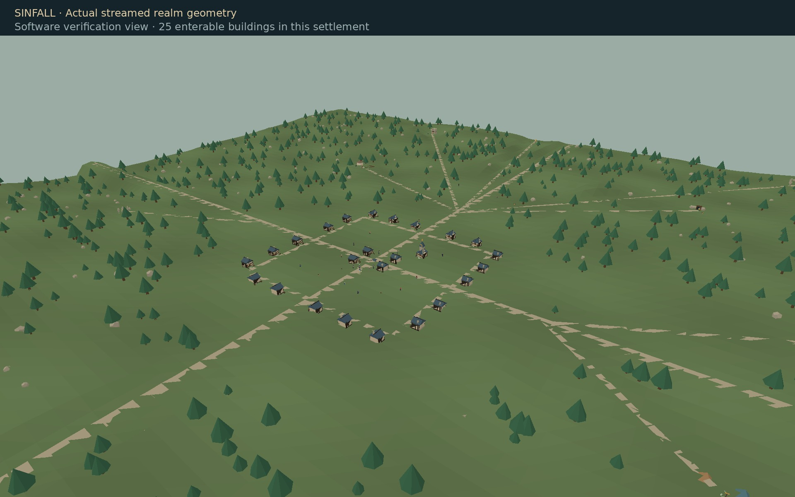
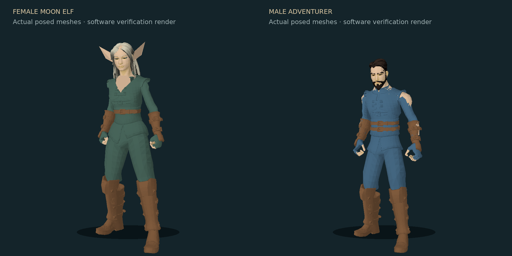
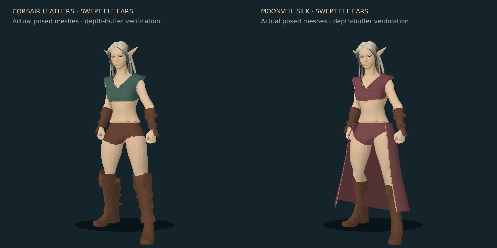
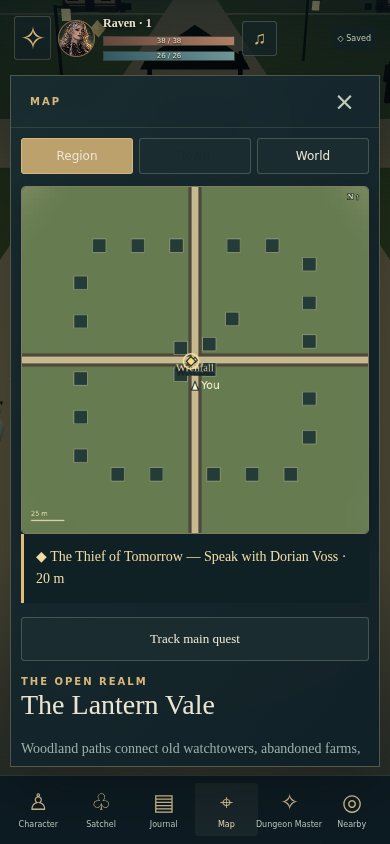

# SINFALL · The Open Realm 2.1.0

[Play Sinfall](https://veribatum.github.io/SINFALL-Realms-of-Temptation/)

A browser RPG with persistent characters, a connected countryside, occupied settlements and branching occult mysteries.

The realm spans **3.6 × 3.6 km**. Walk between **nine settlements** across woodland, highlands, wetlands, snowfields, coast, ashlands, enchanted forest, borderlands and haunted marsh. Physical roads and bridges connect the towns. Nearby terrain, trees and buildings stream as you move, with distant terrain filling the horizon.

Each settlement has an inn, forge, archive, apothecary and chapel, plus twenty homes, shops or halls: **225 enterable buildings** across the realm. Homes have named occupants, furnishings, independent persistent discoveries and stories leading to wilderness landmarks. Explore **72 landmarks and nine seeded undercrypts**. Compact street loops, paths to every doorstep, fortified towns and regional building colors connect the settlements. Every undercrypt gate now has a visible stone tomb, entrance stairs, lamps and signage.

## Your character

Choose Male or Female, eight ancestries, ten classes, an origin and personal history. The new locally bundled adult female/male models have authored faces, eyes, fitted clothing, 65-bone skeletons and eleven animation clips. A female Moon Elf uses the female body with sculpted elven ears and customizable hair and features.

Choose build, height, four face contours, six hairstyles, six female outfit settings (four male settings), skin/hair/eye/cloth colors, facial hair and markings. Weapons and armor change on the actual model. Drag the preview to rotate it. Appearance can be changed later while keeping the hero and progress. Corsair leathers and Moonveil silk add cropped bodices, bare waists and exposed legs to adult female heroes and townsfolk. Elf ears curve back alongside the head.

## Play

Choose **New Game**, **Load Game** or **Continue**. Each hero has independent autosaves, equipment, talents, campaign, world and chronicle. Three manual checkpoints per hero and collection/hero export/import are available. Earlier saves migrate into the continuous realm without losing identity, equipment, quests, claimed resources or surveys. Saves are browser-local; export to move between devices.

Desktop: WASD/arrows walk, drag to look, E interacts, Shift runs, V switches camera. C/I/J/M open Character, Satchel, Journal and Map. Escape closes panels or opens Pause. On a phone, use the joystick, drag the view and tap Interact; the run button toggles running.

Follow the gold marker to the witness. Investigate the road evidence, visit the archive scholar, choose an alliance and enter the undercrypt. Encounters, relationships, faction favors, merchant discounts, side quests, equipment, talents and three endings have mechanical effects. After an ending, begin a different campaign with the same stronger hero and retained legacy.

Mark landmarks or settlements in the atlas. Walking discovers regions; reaching a settlement unlocks fast travel. The minimap follows global position and shows destination distance. Synthesized music covers menus, towns, wilderness, interiors, dungeons and combat; effects and ambience have independent volume controls and persistent mute settings.

## Action combat and story guidance

Combat takes place in the world. Move with the joystick or WASD while selecting Strike, your class ability, Guard, Dodge, Heal or Withdraw. Enemy wind-ups give you time to react; your health and the enemy’s health stay visible. Keyboard shortcuts 1–7 select actions. Settings also retains Classic round combat.

Necromancers unlock **Raise Skeleton at level 2**: 10 mana summons one animated skeleton for 60 seconds to fight and draw enemy attacks. Bone Choir strengthens it. Existing heroes, equipment and campaign progress remain compatible.

The HUD tracks story steps, and Journal explains what happened, why the archive matters, and what to do next. Soft grass/stone footsteps now trigger from the actual walking and running animation contacts rather than an independent timer; blocked movement stays silent.

## Quest navigation and character proportions

Female adult heroes have a **Bust size** slider (70–160%, default 100%) in creation and Character → Change appearance. It shapes the actual skinned torso and fitted clothing, keeps equipment in the preview, and is saved independently for each hero. Existing saves retain their authored proportions.

The main quest tracks automatically. Journal → **Track quest on map** selects a side quest; selection survives reload. Gold diamonds and direction/distance text guide to actual NPCs, entrances, resources, enemies, stairs and quest items. Turn-in markers return to the correct giver. Dungeon routes follow walkable corridors.

Map now draws the game's seeded terrain, river, roads, trails, settlement buildings, landmarks, hero position and quest destinations. Switch between Region, Town, World and Undercrypt views.

## ChatGPT dungeon master

Live ChatGPT is **not connected on the hosted phone edition**. OpenAI's direct open-source plan flow uses a local callback; website sign-in requires an approved client registration. A hosted authentication/inference service is still needed. The game does not present a working-phone sign-in button when that service is unavailable.

The GitHub Pages edition uses six authored mystery frameworks with seeded terrain, names and encounter variation. Import a ChatGPT-written campaign pack for a new story in that edition.

Live ChatGPT uses the local edition and OpenAI's loopback sign-in flow:

1. Download the repository and install Node.js 22 or later.
2. Open **start-sinfall.cmd** on Windows, or run `npm start`.
3. Open `http://127.0.0.1:8787`, then Dungeon Master & Settings → **Continue with ChatGPT**.
4. Authorize eligible ChatGPT plan usage and select an available model.

No dependency installation or API key is required. OpenAI determines account eligibility and consent; usage counts toward the connected plan. No paid API billing fallback is configured. Sign-in and live inference remain unverified with the user's account.

For manual use on a phone, copy the game's campaign request into ChatGPT, then import the returned JSON at the start of a new adventure. Existing active campaigns are protected from replacement.

Credentials stay on the local server under `~/.sinfall/`, excluded from browser responses, saves, logs and the repository. The server binds to loopback and validates client, state, nonce, PKCE, token signature and plan scopes.

Official references: [sign-in](https://developers.openai.com/siwc/token-sharing-open-source/sign-in), [models and inference](https://developers.openai.com/siwc/token-sharing-open-source/models-and-inference), [preview limitations](https://developers.openai.com/siwc/token-sharing-open-source/preview-limitations).

## Development and verification

`npm test` runs 57 game, save, terrain, road, scene, character, OAuth and streaming checks. `npm run check` verifies syntax, local imports, required assets and source hygiene. [Verification details](docs/VERIFICATION.md).

`npm run dev` starts the local preview with AI authorization disabled. Preview-only pages `/__qa/mobile` and `/__qa/models` check the phone layout and actual model/texture decoding. Production local mode does not expose these diagnostics.

WebGL is disabled in the managed verification browser. Normal UI flows were checked through the interaction fallback; actual model downloads, embedded texture decoding and animation startup passed separately. The images above are labeled software projections of committed geometry. GPU appearance, shader compilation, movement feel and device frame rate remain unverified.

Entry point: `index.html` → `src/game.js`. World coordinates and terrain: `src/atlas.js`; scenery streaming: `src/overworld.js`; adult models/style: `src/actors.js` and `src/adult-style.js`; local ChatGPT support: `server/`. Older root scripts remain for history and are not loaded.

Three.js r170: MIT. Adult characters, clothing and animations: Quaternius, CC0. Original KayKit models: CC0. Original licenses and sources are retained in [assets/models/CREDITS.md](assets/models/CREDITS.md). Painted interface artwork is locally bundled in `assets/`.
